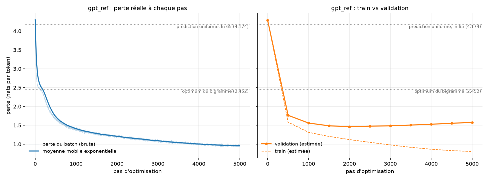
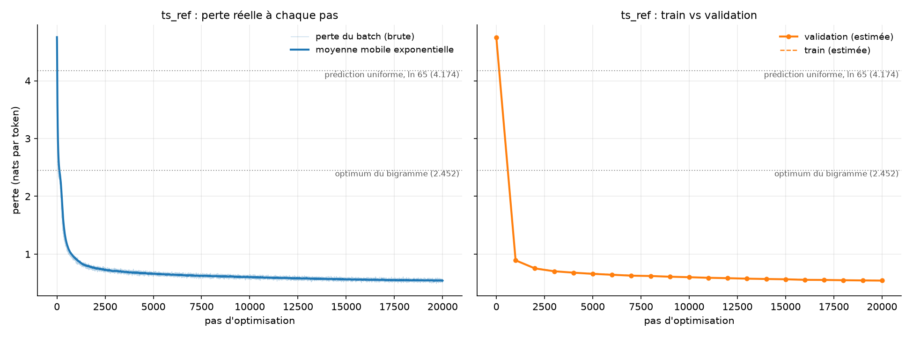

# MiniGPT

A GPT-style language model written from scratch in PyTorch: tokenizer, causal multi-head attention, transformer blocks, training loop and text generation. No Hugging Face model code; every component is implemented and tested by hand.

**Highlights**

- Reproduces the reference validation loss of [nanoGPT](https://github.com/karpathy/nanoGPT) on Tiny Shakespeare: **1.4645** vs 1.4697 (same configuration).
- Trained on **TinyStories-Instruct** (2.66 billion characters) with a memory-mapped data pipeline and bf16 mixed precision, at ~151k tokens/s on a single laptop GPU.
- A small **storyteller app**: give a few words, a theme or story features, and the model writes a short children's story.

## Results

### Tiny Shakespeare (character level, 65 symbols)

| Model | Parameters | Best validation loss |
|---|---|---|
| Bigram (count-optimal floor: 2.452) | 4.2 k | 2.488 |
| GPT, 4 layers, d=128, context 64 | 0.8 M | 1.565 |
| GPT, nanoGPT reference config (6 layers, 6 heads, d=384, context 256, dropout 0.2) | 10.8 M | **1.4645** (nanoGPT: 1.4697) |



With the reference configuration, validation loss reaches its minimum around step 2,000 and then rises while training loss keeps decreasing: 10.8 M parameters overfit a 1 M-character corpus. The best checkpoint is kept (early stopping).

### TinyStories-Instruct (character level, 96 symbols)

| Model | Parameters | Tokens seen | Validation loss |
|---|---|---|---|
| GPT, 6 layers, 6 heads, d=384, context 256, no dropout | 10.8 M | 328 M (12% of the corpus) | **0.542** |

Train and validation losses stay together throughout (no overfitting), and validation loss was still decreasing at the end of training.



Example (prompt exactly as typed: `Words: father, boy, lion` / `Summary: a boy is afraid from a lion` / `Features: MoralValue`):

> Once there was a lion. [...] From then on, the little bear and the lion were best friends and they would play together every day.

The model writes grammatical, well-structured stories but follows instructions only partially (see Limitations).

## What is implemented

| File | Content |
|---|---|
| `dataset.py` | character tokenizer, sliding-window dataset (x, y shifted by one token) |
| `model.py` | bigram language model |
| `gpt.py` | causal self-attention head, multi-head attention, feed-forward, pre-norm transformer block, GPT, autoregressive generation |
| `train_gpt.py` | training on Tiny Shakespeare: AdamW (weight decay on matrices only), warmup + cosine schedule, gradient clipping, dropout, best-checkpoint saving |
| `prepare_data.py` | streams a 2.6 GB text file into a `uint16` binary file chunk by chunk (fixed ASCII vocabulary, Unicode normalisation) |
| `bin_dataset.py` | memory-mapped dataset (`np.memmap`): data stays on disk |
| `train_tinystories.py` | same recipe on TinyStories-Instruct, with sampling with replacement and bf16 autocast |
| `story.py`, `app.py` | storyteller (prompt construction, generation until end-of-text) and its Gradio web app |
| `plots.py` | loss curves from the CSV logs |
| `check_*.py` | tests: tensor shapes, **causality** (changing future tokens must not change past outputs), gradient reaching every parameter, parameter counts against closed-form formulas |

## Reproduce

```bash
# Tiny Shakespeare
python train_gpt.py            # writes results/ and checkpoints/
python sample.py               # prompt -> continuation

# TinyStories-Instruct
# download TinyStories-Instruct-{train,valid}.txt from huggingface.co/datasets/roneneldan/TinyStoriesInstruct
python prepare_data.py         # -> train.bin, val.bin, meta.json
python train_tinystories.py
python story.py                # command-line storyteller
python app.py                  # web app

python plots.py                # figures/
```

Requirements: Python 3.11, PyTorch, NumPy, matplotlib, Gradio.

## Limitations

- **Character-level tokens.** With a 256-character context, the instruction header leaves the window after about 220 generated characters, so the end of a story no longer "sees" the requested words.
- **Instruction following is partial.** The model has learned spelling, grammar and story structure, but only weakly the link between the header and the story.
- **Single runs.** Results above come from one seed each; differences of about 0.01 are within measurement noise.
